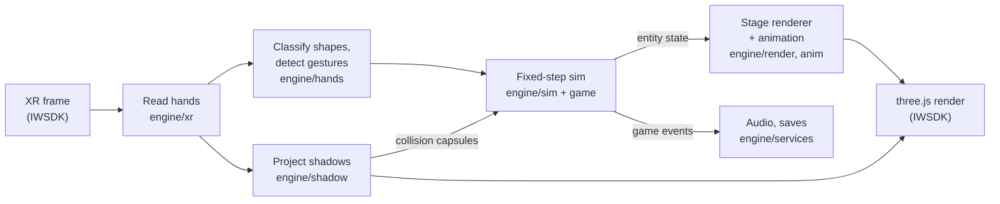

# Architecture

How Where Shadows Wander is put together: the layers, what runs each frame, which module does what, and the frame budget. The decisions behind it are in the [ADRs](adr/).

## Layers

```
IWSDK + three.js        XR session, renderer, display loop, emulator
        │
Engine-facing code      src/app, src/engine/xr, src/engine/shadow, src/engine/render,
        │               src/engine/anim (adapters), src/engine/services, src/ui, src/debug, src/input-mock
        │
Pure code               src/engine/hands, src/engine/sim, src/engine/stage, src/game, src/engine/shadow/pure
                        (plain TypeScript; no IWSDK, three.js or browser globals)
```

- **IWSDK** owns the XR session, the renderer and the display loop. We use it for the session and the emulator, and nothing else: v1 is a virtual room, so no scene understanding, planes or anchors, and sound is plain Web Audio ([ADR 0008](adr/0008-audio.md)); IWSDK's own audio system is still registered and makes its own audio context, so the page has two. Game state never goes into IWSDK's ECS ([ADR 0001](adr/0001-iwsdk-as-xr-and-view-layer.md)).
- **Engine-facing code** talks to IWSDK, three.js, WebXR and the DOM. It turns the outside world into plain data, and plain data into things on screen.
- **Pure code** holds the logic: hand maths and the classifier, the simulation, stage geometry and gameplay. It's unit-tested in Node and can't see the engine, which ESLint enforces. This is also why the plain three.js fallback stays cheap ([ADR 0002](adr/0002-plain-threejs-fallback.md)).

## One frame

IWSDK calls `renderer.setAnimationLoop` and runs its systems in priority order. We register exactly one system, `FrameDriverSystem` in `src/app/main.ts`, at priority 10. It runs after IWSDK's input (−4) and scene understanding (−1) systems and before rendering. Everything of ours runs inside it, in this order:



1. **Read hands and capabilities** (`engine/xr`): raw WebXR joints into `HandFrame`, 25 joints per hand in scene space ([ADR 0004](adr/0004-webcam-bench-and-hand-recordings.md)). In mock mode the webcam or a recording fills the same `HandFrame`. `CapabilityDetector` keeps one `Capabilities` object up to date (hands, passthrough, planes, meshes, anchors) and the detected planes as `DetectedPlane` records in scene space, normals toward the viewer, for StageFrame.
2. **Classify** (`engine/hands`): features, then the shape classifier with hold-to-commit and hysteresis, which emits shape events (`ShapeRecognizer`). Then the lantern gestures on the same features (`GestureDetector`): pinch-and-release to place or relight, a closed hand over the flame to pause.
3. **Shadows** (`engine/shadow`): `ShadowProjector` (pure, in `shadow/pure`) projects each hand onto the stage from the lantern with one matrix blended toward orthographic (k = 0.9), filling `HandShadow` (in `engine/hands`, for the solver): 28 capsules per hand in 2D stage space, an outline and an edge blur. `ShadowRenderer` draws both hands from those capsules in one draw call, soft-edged and clipped to the stage. In a headset the stage is A's `StageFrame` and the lantern is placed by `placeLantern` (`shadow/pure/test-rig.ts`) until the lantern flow exists; the Hand Lab's default tabletop theatre is the stand-in rig (`?stage=real` shows the real wall).
4. **Simulate** (`engine/sim`, `game`): the fixed-step loop advances the 2D simulation at a constant rate, whatever the display rate (72, 90 or 120 Hz). It returns an interpolation factor for rendering.
5. **Present** (`engine/render`, `engine/anim`): draw entity state (interpolated) as instanced sprites with animation poses.
6. **Services** (`engine/services`): audio and saves react to game events and never block a frame.
7. IWSDK renders the scene.

The stage is a 2D world on one surface, the fixed virtual wall of the room. `StageFrame` (`engine/stage`) converts between 3D scene space and 2D stage space; a real table or wall (a possible later mode) would only supply a different frame.

## Modules

| Folder | Owner | Pure | Responsibility |
|---|---|---|---|
| `src/app` | Anson | No | Entry point: `World.create`, the driver system, wiring, the no-AR notice, IWSDK manifests |
| `src/engine/xr` | Anson | No | WebXR hand reading, capability detection, IWSDK workarounds, hand recorder, the hand visual (glove) |
| `src/engine/hands` | Anson | Yes | `HandFrame`, derived palm, shape features, classifier, gestures, recording format |
| `src/engine/shadow` | Anson | No (`pure/` yes) | Projected-shadow renderer; `pure/`: projection maths, capsules, stand-in rig |
| `src/input-mock` | Anson | No | Hand Lab (`?mock=1`) and its hand sources, webcam bench, MediaPipe conversion and worker |
| `src/engine/sim` | A | Yes | Fixed-step loop, 2D collision solver, entities, object pools, the loader that turns editor-authored scene files into entities ([ADR 0006](adr/0006-editor-authored-layouts.md)) |
| `src/engine/stage` | A | Yes | `StageFrame`: 3D ↔ 2D for the fixed virtual wall (a real surface in a later mode) |
| `src/game` | A | Yes | Traveller, shape abilities, puzzles, companions, discovery |
| `src/engine/render` | B | Adapters no | Stage renderer: instanced sprites, draw order, materials |
| `src/engine/anim` | B | Core yes | Procedural rod-puppet animation |
| `src/engine/services` | Anson (B owns the content: sounds, gallery) | Adapters no | Saves (`saves/`: two checksummed slots, migrations, ADR 0010), assets (`assets/`: budgets, manifest-from-files, loader; ADR 0009), audio |
| `src/ui` | B | No | Onboarding, lantern flow, placement, chapter flow, settings |
| `src/debug` | B | No | Diagnostics report, anchor probe, profiler, Copy report panel |

"Adapters no" means only the thin layer that talks to IWSDK or three.js may import them; the logic behind it stays pure.

## Frame budget

At 72 fps a frame has **13.9 ms**. Judges require at least 60 fps (16.7 ms), so 72 gives margin. These are **CPU** budgets per frame. GPU time is separate, so measure it on the Pico.

| Module | Owner | Budget |
|---|---|---|
| IWSDK systems and three.js render submission | (engine) | 4.0 ms |
| Read hands, capabilities | Anson | 0.4 ms |
| Features, classifier, gestures | Anson | 0.7 ms |
| Shadow projection and capsules | Anson | 0.9 ms |
| Hand visual | Anson | 0.2 ms |
| Simulation and gameplay (all fixed steps in the frame) | A | 2.0 ms |
| Stage renderer and animation | B | 2.3 ms |
| Services (audio, saves, asset streaming) | B | 0.5 ms |
| Diagnostics and profiler | B | 0.3 ms |
| **Headroom** | | **2.6 ms** |
| **Total** | | **13.9 ms** |

These are starting estimates. Desktop measurements so far: our whole frame was about 0.06 ms, and 500 instanced quads about 0.08 ms. Expect a headset to be 3–5× slower. Teammate B's profiler (`src/debug`) will measure each module against this table on the Pico, and the table should be updated from real numbers.

### Measuring it

| What | How | What it tells you |
|---|---|---|
| Our stages on a headset | `perf` in the diagnostics report (Copy report): `msAvg` and `msWorst` per stage (`read`, `classify`, `gestures`, `shadow`, `handVisual`, `audio`, `lab`, `total`; the shape-event sounds are timed inside `shadow`; `frameErrors` counts any part of the frame that threw) over the last 300 frames | Compare each stage with the table above. Browsers coarsen timers on Pages, so trust averages, not single frames |
| Our stages on a desktop | `npm run perf` | Per-stage time per frame. Headset budget divided by 4 is the desktop guide: read 0.1 ms, classify and gestures 0.175 ms, shadow 0.225 ms. Measured 3 Oct 2026: recognizer 3.4 µs, shadow 4.3 µs per frame |
| Allocation | `frame-pipeline.alloc.test.ts`, part of `npm test` | Runs recognizer, gestures and projector for 3,000 frames with no garbage collection inside the window (it fails if one runs) and fails above 700 B a frame. The stages build no objects or arrays. Measured about 530 B a frame (recognizer, gestures, projector, sharpen and lantern light), which is the engine boxing numbers returned by small helpers; it was 6.9 KB until `Math.hypot` (which allocates) was replaced with `Math.sqrt` in the hot paths |
| GPU time | Pico or Quest performance overlay | Not visible from JavaScript. Check with both shadows covering the stage and `?debug=shadow` |

## The virtual room (v1)

The game runs in an `immersive-vr` session, seated (`local-floor`), and, beyond the `local-floor` and `bounded-floor` reference spaces, asks the headset for one feature: `hand-tracking`. The decision and its trade-offs are in [ADR 0005](adr/0005-virtual-room.md).

**How the session starts.** `iwsdk.config.json` sets `xr.mode` to `vr`, so IWSDK's own enter offer (`navigator.xr.offerSession`, which a headset browser may show as its own enter prompt; not yet seen on a Quest) and `world.launchXR` both ask for `immersive-vr`. The page launcher (`src/app/enter-ar-button.ts`) mounts whenever the browser has `navigator.xr`, next to any native prompt, and has its own Enter VR buttons asking for exactly `local-floor`, `bounded-floor` and `hand-tracking` (and an Enter AR button when the browser supports AR). On a browser with no enter prompt of its own, such as the Pico's, it is the only way in. IWSDK adds one more optional feature, `layers`, to the requests it makes itself, whatever the config says. The launcher's Enter AR button, or `?xr=ar` for IWSDK's own offer, starts the old passthrough session instead (`src/engine/xr/session-mode.ts`: the mode, the occluder default and the background rule, all unit-tested). On an opaque display (VR) the scene has a solid dark background and the frame clears opaque; passthrough clears to transparent. The `render` section of the diagnostics report shows `urlMode` (what the page address asks for: the launcher's own buttons can request the other mode), `blendMode` (what the session actually got) and `handOccluder`.

| Part | How it works | Owner |
|---|---|---|
| The room | A small scene: table, lantern, the paper wall, a shelf for the creature gallery, lit by the lantern. Opaque geometry; scenery near the shadows stays light and low-contrast | B |
| The stage | The paper wall is a `StageFrame` (`engine/stage`, structurally a `StagePlane`): `placeInFront(head, yaw)` puts it upright 2 m ahead, 1.6 × 1.0 m, 0.2 m below the eyes, facing the player, when the session starts and again on a recentre. `main.ts` uses it in a headset and with `?mock=1&stage=real`; the Hand Lab's default tabletop theatre is the old stand-in (`test-rig.ts`, also tests). The projector blends 0.65 toward orthographic on the real wall with a low edge blur (`shadow/pure/real-wall.ts`), so a puppet hand casts a steady shadow about 15 × 35 cm (`stage-frame-geometry.test.ts`: with full perspective the shadows are several times too big and leave the wall). A bad head pose is ignored, not thrown on (`placeRig`). No plane detection and no fallback. The shadow renderer lifts the shadow 2 mm off the wall as before | A (frame), B (look) |
| The hands | The player cannot see their real hands, so `HandVisual` (`engine/xr/hand-visual.ts`) draws them from the 25 joints. `CapsuleHandVisual` is the first look: a flat dark glove from the shadow's own capsule pairs (`CAPSULE_JOINTS`), 2 instanced draw calls, about 0.01 ms a frame on a desktop, and under 64 bytes a frame in its allocation test. It draws after the paper and before the shadow without writing depth, so the shadow always draws over a hand that overlaps it. Each hand fades in over 0.15 s and out over 0.4 s when tracking is lost or the game is paused, drawn from its last fully tracked pose (the reader leaves stale joints in a partly tracked hand), (`hand-fade.ts`; an ordered dither, not blending, so overlapping joints do not show as blobs), and warms near the flame like the debug dots do (`candle-tint.ts`). It hides itself when the session's blend mode is not opaque (passthrough), whatever `?occlude` says. Known limit: it writes no depth, so the candle's flame shows through a hand held in front of it. A different look (a model, a paper-cut glove) implements `HandVisual` and replaces the one line in `main.ts` that makes it; the shadow comes from the joints, never from the model. The joint dots are a debug view: `?debug=joints` | Anson (rig and mapping), B (art) |
| No-hands cue | `HandsStatus` (`engine/xr/hands-status.ts`) turns the hand reader's output into `tracking`, `lost` or `unavailable`. With no tracked hand for 3 s, or no hand input source at all for 5 s (hand tracking off, controllers held, a browser that does not pass joints), a panel in front of the wearer says "Show me your hands" (`PromptPanel`, a second instance) and goes away the moment a hand is tracked. A frame step is counted up to 0.1 s, so the first frame after the headset was off does not read as a long dropout. This assumes a runtime keeps a hand's input source while the hand is out of view; if one drops it, a player resting their hands for 5 s would see the unavailable text. Check on a Pico by dropping the hands out of view and looking for `-(…:hand)` in `xrInput.readerEvents` in the diagnostics report. The thresholds and the two short texts are constants at the top of the file | Anson (signal), B (text) |
| Pause | `SessionVisibility` (`engine/xr/session-visibility.ts`) follows `session.visibilityState` (IWSDK also keeps `world.visibilityState`; this copy is Node-testable and survives the plain three.js fallback). `paused` is true for `hidden` and `visible-blurred` (the system menu has focus and no hand data arrives); `subscribe(fn)` is called on each change, for saves. The driver system skips hand reading, classification and `sim.advance` while `paused`, so nothing runs ahead of a game that is not being played. A reads `paused` (or subscribes); the sim loop itself has no pause switch | Anson (signal), A, B |

Switched off for v1 (still in the repository for a possible real-room mode): `HandOccluder` (**it follows the session**: off in VR, where the display is opaque and a depth-only hand would cut a hole in the room behind it, and on over passthrough; `?occlude=1` or `?occlude=0` overrides it for testing), the plane tracker and plane capabilities, the passthrough compositing rules below, and the composite probe. The hand-tracking, shape, gesture, shadow, sharpen, flicker and performance work is used as built.

## Compositing over passthrough (real-room mode only; not used in v1)

The stage and shadows are drawn into the same frame as the room camera image (`immersive-ar`, `alpha-blend`). What we hand the compositor, and how it is kept right:

| Rule | Why |
|---|---|
| The frame clears to transparent black and the scene has no background | IWSDK sets this itself in an AR session (the report's `render.clearAlpha` shows it); three clears to transparent in an `alpha-blend` session anyway |
| Stage materials are `transparent`, `premultipliedAlpha: false` and `toneMapped: false` | Blending `src-alpha` over a transparent clear stores premultiplied colour, which is what the compositor expects. Black stays black whatever tone mapping a scene environment adds |
| Draw order: hand occluder -1, paper 1, hand visual 1.5, shadow 2, debug and stage sprites 3, joint dots 4 (debug only) | Opaque things draw first, then the transparent paper and shadow, then overlays |
| `HandOccluder` draws each hand into the depth buffer only (no colour) | The paper and shadow cover the camera image, so without it a real hand held in front of the stage would be hidden behind them. Fragments behind the occluder fail the depth test and the camera image shows through. On whenever the session is passthrough, off in VR; `?occlude=0` turns it off to compare |
| Any colour shader we add includes `colorspace_fragment` | The XR target is sRGB. Only black-only shaders (the shadow) may skip it |

The lantern's glow (`LanternGlow`) is a camera-facing quad with a bright core and a soft halo, drawn at order 3 with ordinary alpha blending (never additive, which would vanish on a passthrough display) and `colorspace_fragment`. It and the paper's shimmer read one `LanternLight` (position, lit, intensity, colour) from `LanternLightModel`; Teammate B's lantern flow sets `lit` and the position.

Without a headset: `scripts/composite-probe.mjs <dev server URL>` renders the live scene into an sRGB RGBA8 target like WebXR's and reads the pixel at four stage points: off the stage (alpha 0), bare paper (alpha 0.85, premultiplied), inside a shadow (alpha 0.98), and paper behind a hand (alpha 0 with the occluder on). It cannot show what the headset's compositor then does with the frame; see the headset checklist in the pull request for #13.

The diagnostics report has a `render` section (`clearAlpha`, `toneMapping`, `outputColorSpace`, `blendMode`, `layer`, `handOccluder`) to read this off a real session. Stop and report if the blend mode is `additive` or `opaque` (black shadows are invisible on an additive display) or the tone mapping is not `none`. `clearAlpha` shows IWSDK's setting; in an `alpha-blend` session three clears to transparent whatever it says, so `blendMode` is the field that matters.

## Rules that keep it working

| Rule | Why |
|---|---|
| Pure code never imports the engine or browser globals | Logic stays unit-testable in Node, and the engine can be swapped ([ADR 0002](adr/0002-plain-threejs-fallback.md)) |
| No objects or arrays built in per-frame code (reuse structs and typed arrays) | Garbage collection pauses cause dropped frames on a headset; `frame-pipeline.alloc.test.ts` guards it |
| One driver system; our own fixed-step loop | Simulation is deterministic and independent of display rate; IWSDK's private loop stays untouched ([ADR 0001](adr/0001-iwsdk-as-xr-and-view-layer.md)) |
| Raw WebXR, every feature optional and feature-detected | Works on Pico, Quest and the emulator alike ([ADR 0003](adr/0003-pico-as-stand-in-test-device.md)) |
| Exact version pins; one three.js | IWSDK is young and pins its own three.js fork ([ADR 0001](adr/0001-iwsdk-as-xr-and-view-layer.md)) |
| Lucide icon set aliased out | First load 0.7 MB instead of 1.7 MB ([ADR 0001](adr/0001-iwsdk-as-xr-and-view-layer.md)) |
| No top-level `await` in entry files | Deadlocks IWSDK's lazy chunk in production builds |
| IWSDK's hand meshes hidden every frame, its rays turned off | Players see their real hands in passthrough and never point at anything; IWSDK's own hand toggle doesn't work |

## Builds and deploys

- `npm run dev`: IWSDK's dev server with HTTPS and the IWER emulator (Quest 3, synthetic living room).
- `npm run build`: production build in `dist/`, with two pages: `index.html` (the game, and the Hand Lab with `?mock=1`) and `webcam.html` (the webcam bench). MediaPipe loads only on the bench and in the Hand Lab's webcam worker, never in the game's first load. Relative URLs, so it works under a GitHub Pages subpath.
- CI (`.github/workflows/ci.yml`) runs `npm run check` and a build on every PR. Merging to `main` deploys to GitHub Pages (`.github/workflows/pages.yml`).
