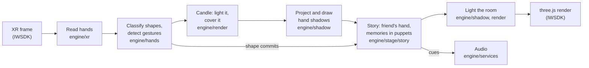

# Architecture

How Where Shadows Wander is put together: the layers, what runs each frame, which module does what, and the frame budget. The decisions behind it are in the [ADRs](adr/).

## Layers

```
IWSDK + three.js        XR session, renderer, display loop, emulator
        │
Engine-facing code      src/app, src/engine/xr, src/engine/shadow, src/engine/render,
        │               src/engine/anim (adapters), src/engine/services, src/ui, src/debug, src/input-mock
        │
Pure code               src/engine/hands, src/engine/stage, src/engine/shadow/pure
                        (plain TypeScript; no IWSDK, three.js or browser globals)
```

- **IWSDK** owns the XR session, the renderer and the display loop. We use it for the session and the emulator, and nothing else: v1 is a virtual room, so no scene understanding, planes or anchors, and sound is plain Web Audio ([ADR 0008](adr/0008-audio.md)); IWSDK's own audio system is still registered and makes its own audio context, so the page has two. Game state never goes into IWSDK's ECS ([ADR 0001](adr/0001-iwsdk-as-xr-and-view-layer.md)).
- **Engine-facing code** talks to IWSDK, three.js, WebXR and the DOM. It turns the outside world into plain data, and plain data into things on screen.
- **Pure code** holds the logic: hand maths and the classifier, shadow projection, stage geometry, and the story (its running order, puppet scenes and timelines, all as numbers). It's unit-tested in Node and can't see the engine, which ESLint enforces. This is also why the plain three.js fallback stays cheap ([ADR 0002](adr/0002-plain-threejs-fallback.md)).

## One frame

IWSDK calls `renderer.setAnimationLoop` and runs its systems in priority order. We register exactly one system, `FrameDriverSystem` in `src/app/main.ts`, at priority 10. It runs after IWSDK's input (−4) and scene understanding (−1) systems and before rendering. Everything of ours runs inside it, in this order:



1. **Read hands and capabilities** (`engine/xr`): raw WebXR joints into `HandFrame`, 25 joints per hand in scene space ([ADR 0004](adr/0004-webcam-bench-and-hand-recordings.md)). In mock mode the webcam or a recording fills the same `HandFrame`. `CapabilityDetector` keeps one `Capabilities` object up to date (hands, passthrough, planes, meshes, anchors) and the detected planes as `DetectedPlane` records in scene space, normals toward the viewer, for StageFrame.
2. **Classify** (`engine/hands`): features, then the shape classifier with hold-to-commit and hysteresis, which emits shape events (`ShapeRecognizer`). `GestureDetector` still runs on the same features, but nothing listens to its events since the candle stopped moving (only the diagnostics count them).
3. **The candle** (`engine/render/candle-view.ts`): before the story the matchstick lights it (`IgnitionHold`, `engine/stage/ignition.ts`); after that a hand held over the flame covers it (`CandleView.isCovered`, read from the hands, not from a gesture). Covering pauses the story; in scene 7 it is how the player falls asleep. The candle never moves: it stands on the bed tray's saucer.
4. **Shadows** (`engine/shadow`, [ADR 0019](adr/0019-cast-hand-shadows.md)): the hands' shadows are cast. `HandShadowMap` (`shadow/hand-shadow-map.ts`, owned by `CandleLight` as `candleLight.hands`) draws the hand visual's meshes (the glove the player sees, skinned or instanced) from a light into a cube distance map (512² a face, all round the light) once a frame, after the hands are posed; every candle-lit surface (every wall, the floor, ceiling, bed and tray) and the stage's paper looks it up and loses the candle's light where a hand is nearer the light, with a soft edge that widens with the distance behind the hand (a sized light, searched and filtered per pixel). The light is not the flame: the candle is low and just behind resting hands, so it is `castPoint` (`shadow/pure/real-wall.ts`), 1.2 m behind and 0.3 m above the flame. `ShadowProjector` (pure, in `shadow/pure`) projects the joints from that same point in plain perspective, filling `HandShadow` (in `engine/hands`): 28 capsules per hand in 2D stage space and an outline. Nothing draws them; they are where the story, the sounds and the debug view (Alt+K) find each hand's shadow, and they match the drawn one. The stage is the wall's `StageFrame`, in a headset and in the Hand Lab alike, and the candle stands on the bed tray's saucer (`placeRig` in `main.ts`). How dark the shadow is, is the game's: `HandPresence` makes it faint while a memory plays and full when the story waits for a hand (`handShadow.strength` in `main.ts`), and a recognised shape sharpens its edge (`ShadowSharpen`). The gloves themselves do not take the hands' shadows.
5. **The story** (`engine/stage/story`, drawn by `engine/shadow/puppet-view.ts`; [STORY.md](STORY.md), [ADR 0016](adr/0016-story-shadow-theatre.md)): see [The story](#the-story) below. It holds still while the game is paused or the flame is covered.
6. **Light the room** (`engine/shadow`, `engine/render`): the lantern light follows the candle's flame and flicker, tinted by the story's candle mood (`CandleMoodBlend`), and the paper wall, the bedroom, its dressing and the candle read it. The room's light spreads out from the flame once the candle is lit, draws back while the flame is covered (the pause), dims with scene 2's hush (`LightHush`) and under scene 7's ghost hand (`SleepHint`), and goes out with the ending. The storm outside (`engine/stage/storm.ts`) flashes the window.
7. **Audio** (`engine/services/audio`): one music track from the candle's lighting to the end; rain, thunder and the story's cue sounds (footsteps, laughter, her torch's click, a yawn) placed where they happen on the wall or in the room; a shape being let go makes a soft sound from where that hand's shadow is (recognising and committing a shape are silent); captions name the sounds on the wall. Saves are written only on events (the headset coming off, the session ending, the page hidden), never per frame.
8. IWSDK renders the scene.

The opening and the end are timelines that run around this: `WakeTimeline` (scene 1: black, thunder, the eyes opening) before the candle is lit, and `EndingTimeline` (the candle going out, the eyes closing, the credits, the session ending) once the flame is covered in scene 7. There is no fixed-step simulation; everything steps on the frame's `dt`.

## The story

The seven scenes are written in [STORY.md](STORY.md); this is how the code plays them.

- **Running order.** `StoryDirector` (`story/story-director.ts`) plays `STORY_SCRIPT` (`story/story-script.ts`): each scene is a list of beats. A `friend` beat shows the friend's hand making a shape and waits, for as long as it takes, until the player's hand commits that shape (`story.commit` from the shape events). A `memory` beat plays one chapter of the puppet show to its end. Scene 1 (waking) runs before the script, from the candle; scene 7 ends with `waitingForSleep`, which the covered flame answers.
- **One puppet show.** Every memory is a chapter (`the-storm.ts`, `how-they-met.ts`, `the-park.ts`, `fireflies.ts`, `last-ordinary-day.ts`, `goodbye.ts`) joined end to end into one `PuppetScene` (`puppet/chapters.ts`, `story/story-stage.ts`), so the kids, the rabbit and the places carry over and the wall never goes blank. `story-kit.ts` has the stock puppets and moves. A `PuppetScene` is plain data: cut-out parts hung from each other at pivots, keyframed tracks and cues. `ScenePlayer` (`puppet/scene-player.ts`) compiles it into flat arrays on load and samples a pose as a pure function of the time, so a skip or seek can't leave a part half-way, and a frame allocates nothing.
- **Cues.** A scene's cues change the candle's mood, strike the storm, play a step or a sound from a point on the wall, hush the light, or write a word on the wall (`StoryLineView`). `main.ts`'s `onStoryCue` routes them.
- **The friend's hand.** A painted shadow of a child's hand making the shape (`story/friend-puppet.ts`), played by time as a puppet of its own. `ShapeGuide` reads how near the player's hand is to her shape and leans her hand and steadies the flame as it gets close; an outline of her shape sits on the player's shadow to fill.
- **The end.** `SleepHint` shows a ghost hand (`engine/render/ghost-hand-view.ts`) covering the flame, stronger the longer the wait, then one word. Covering the flame plays `EndingTimeline`.
- **Where it draws.** The story has its own `StageFrame`, `storyFrame`: the same wall at `STORY_SCALE` (2.375) times the stage, centred on the wall (`setStoryArea`), so the memories fill most of the 4 × 2.5 m wall. Puppets are clipped to the wall's edges. The player's own shadow and the captions keep the stage.
- **Testing.** The Hand Lab's Story tab has a checkpoint for every scene and can make the waiting shape with synthetic hands; `__wsw.playStory()` restarts it in dev.

The stage is a 2D world on one surface, the fixed virtual wall of the room. `StageFrame` (`engine/stage`) converts between 3D scene space and 2D stage space; a real table or wall (a possible later mode) would only supply a different frame.

## Stage frame: `src/engine/stage/stage-frame.ts`

`StageFrame` is the 2D coordinate system on the paper wall of the virtual room ([ADR 0005](adr/0005-virtual-room.md)). The hands' shadows are projected into it.

- **Spaces.**
  - The origin is the wall's centre.
  - Stage +x runs along `right`, and stage +y along `up` the wall.
  - `normal` points out of the wall, toward the player and the candle.
  - The basis is orthonormal and right-handed (`right × up = normal`), with the same axes as the stand-in `placeTestRig('wall', ...)`.
- **Placing it.**
  - `placeInFront(head, yaw)` places the wall once when the room is built. It sits `WALL_DISTANCE_M` (2 m) ahead and `WALL_CENTRE_BELOW_EYES_M` (0.2 m) below the eyes, upright, at `WALL_WIDTH_M × WALL_HEIGHT_M` (1.6 × 1.0 m). These are constants to tune in the headset.
  - `setWall(centre, normal, upHint, w, h)` takes any plane. It is there for a possible real-surface mode later.
  - Every change bumps `version`.
- **Converting.**
  - `toStage(x, y, z, out)` projects a scene point straight onto the wall. It returns the point's distance in front of the wall.
  - `toScene(sx, sy, out, offset)` goes the other way, `offset` metres in front of the paper.
  - `contains(sx, sy, margin)` tests whether a stage point is on the wall.
  - None of these allocate.
- **With the shadow projector.** `StageFrame` has exactly the fields of `StagePlane`/`MutableStagePlane` in `src/engine/shadow/pure/stage-plane.ts`, so it is passed straight to the projector. Pure code may not import `shadow/`, so the match is structural; `main.ts`'s typecheck enforces it.
- **Dropped by ADR 0005:** choosing a table or wall, snapping to detected planes, and a placement fallback.

## Modules

No folder has an owner: anyone on the team edits any of them.

| Folder | Pure | Responsibility |
|---|---|---|
| `src/app` | No | Entry point: `World.create`, the driver system, wiring (the story, the wake and the ending included), the launcher and title, the 🛠 Dev overlay, capture mode, frame timings, the no-XR notice, IWSDK manifests |
| `src/engine/xr` | No | WebXR hand reading, capability detection, the no-hands cue, session visibility, IWSDK workarounds, hand recorder, the hand visual (glove) |
| `src/engine/hands` | Yes | `HandFrame`, derived palm, shape features, classifier, gestures, the covering hand, synthetic hands, recording format |
| `src/engine/shadow` | No (`pure/` yes) | Projected-shadow renderer; the bedroom's dressing and placed models, the puppet view, the story's ink lines, the wake's lids and fades; `pure/`: projection maths, capsules, lantern light, sharpen, the skip touch, stand-in rig |
| `src/engine/stage` | Yes | `StageFrame`: 3D ↔ 2D for the fixed virtual wall (a real surface in a later mode); the room layout file; `story/`: the story's running order, script, chapters and helpers; `puppet/`: puppet scenes and their player; the wake, ignition, storm and ending timelines |
| `src/engine/render` | No | The candle, the title lighter, the ghost hand, the bedroom and the bed tray |
| `src/engine/services` | Adapters no | Saves (`saves/`: two checksummed slots, migrations, ADR 0010), settings (`settings/`: the accessibility settings table and the store that applies them live, ADR 0011), assets (`assets/`: budgets, manifest-from-files, loader; ADR 0009), audio (`audio/`: Web Audio engine, mixer and voice pool, recorded and placeholder sounds, captions) |
| `src/engine/testing` | Yes | Shared test helpers: the allocation meter and the frame-pipeline fixture and allocation test |
| `src/ui` | No | The title screen, the wall menu and pause, the settings panel (`settings-panel/`, ADR 0011), the credits |
| `src/input-mock` | No | Hand Lab (mock hands in the game's session, chosen on the page: `src/app/launch-mode.ts`, [ADR 0018](adr/0018-hand-lab-in-session.md)) with its Steps and Story tabs and hand sources, the desk-to-rig mapping, webcam bench, MediaPipe conversion and worker |
| `src/debug` | No | Diagnostics report, anchor probe, profiler, Copy report panel; the debug tools (overlays, system switches, replay, keys, menu pages), dev and tester builds only ([ADR 0012](adr/0012-debug-tools.md)) |

"Adapters no" means only the thin layer that talks to IWSDK or three.js may import them; the logic behind it stays pure.

## Frame budget

At 72 fps a frame has **13.9 ms**. Judges require at least 60 fps (16.7 ms), so 72 gives margin. These are **CPU** budgets per frame. GPU time is separate, so measure it on the Pico.

| Module | Budget |
|---|---|
| IWSDK systems and three.js render submission | 4.0 ms |
| Read hands, capabilities | 0.4 ms |
| Features, classifier, gestures | 0.7 ms |
| Shadow projection, and the hands' shadow map pass | 0.9 ms |
| Story: director, puppet scenes, friend's hand, ink lines | 1.0 ms |
| Hand visual | 0.2 ms |
| Room lighting and views | 2.3 ms |
| Services (audio, saves, asset streaming) | 0.5 ms |
| Diagnostics and profiler | 0.3 ms |
| **Headroom** | **3.6 ms** |
| **Total** | **13.9 ms** |

These are starting estimates; the story's 1.0 ms came out of the headroom when it was built. Desktop measurements so far: our whole frame was about 0.06 ms, and 500 instanced quads about 0.08 ms (both before the story). Expect a headset to be 3–5× slower. The profiler (`src/debug`, `src/app/frame-timings.ts`) measures the frame on the Pico, and the table should be updated from real numbers. Its slots don't match the table yet: the story runs inside the `shadow` slot, so that slot's number is shadows and story together.

How to measure against this table, and the numbers so far, are in [PERFORMANCE.md](PERFORMANCE.md).

## The virtual room (v1)

The game runs in an `immersive-vr` session, seated (`local-floor`), and, beyond the `local-floor` and `bounded-floor` reference spaces, asks the headset for one feature: `hand-tracking`. The decision and its trade-offs are in [ADR 0005](adr/0005-virtual-room.md).

**How the session starts.** `iwsdk.config.json` sets `xr.mode` to `vr`, so IWSDK's own enter offer (`navigator.xr.offerSession`, which a headset browser may show as its own enter prompt; not yet seen on a Quest) and `world.launchXR` both ask for `immersive-vr`. The page launcher (`src/app/enter-ar-button.ts`) mounts whenever the browser has `navigator.xr`, next to any native prompt, and its title screen's BEGIN asks for exactly `local-floor`, `bounded-floor` and `hand-tracking`. On a browser with no enter prompt of its own, such as the Pico's, it is the only way in. BEGIN is the one way in on every build: it steps down to fewer features if the runtime rejects some, retries with the older `XRWebGLLayer` if three.js can't bind a projection layer, and shows a plain message if a start still fails. In dev the emulator's own Enter XR bar is hidden (`src/app/emulator-offer.ts`). The **🛠 Dev** overlay (page UI: the Hand Lab, recordings, the test flicker, errors, the room editor and the debug switches; `src/app/developer-overlay.ts`), the launch log shown when BEGIN fails, and the "Copy report" panel are debug tools (`src/debug/debug-flag.ts`), shown only in dev and tester builds and kept out of the judges' bundle by `npm run check:debug-free`. IWSDK adds one more optional feature, `layers`, to the requests it makes itself, whatever the config says. The passthrough (AR) mode is gone ([ADR 0017](adr/0017-one-address.md)). On an opaque display (VR) the scene has a solid dark background and the frame clears opaque (`src/engine/xr/session-mode.ts`); a see-through display would clear to transparent. The `render` section of the diagnostics report shows `blendMode` (what the session actually got).

**What the page starts as.** The address is always the plain page: no query options. `src/app/launch-mode.ts` keeps the mode (`game`, or `room-editor` in dev and tester builds) and whose hands play (`device`, or a Hand Lab mock source in dev and tester builds) in the tab's `sessionStorage`, with whether the Hand Lab panel shows. The panel and the hands change live (the 🛠 Dev overlay's **Hand Lab panel** button, the panel's sources); only the room editor reloads. The game always runs in a session; mock hands only replace the device's hands in it, and the room editor is the one mode with no session ([ADR 0018](adr/0018-hand-lab-in-session.md)). The testing switches are in `localStorage` (`src/app/testing-options.ts`). Probe scripts set both before the page loads and press BEGIN to enter the emulator's session (`scripts/lib/launch.mjs`).

| Part | How it works |
|---|---|
| The room | A lived-in bedroom lit by the candle and a faint moon, whose beam through the window falls on the desk and the bed (`engine/shadow/candle-light.ts`): the bed and its tray with the candle on its saucer, the paper wall, a window with the storm outside, a desk, wardrobe, door and nightstand, her jar and torch, moving boxes and a toy fox (`engine/render/room`, `engine/shadow/room-dressing-view.ts`, models placed from the layout file; [ASSETS.md](ASSETS.md)). The candle never moves. Opaque geometry; scenery near the shadows stays light and low-contrast |
| The stage | The paper wall is a `StageFrame` (`engine/stage`, structurally a `StagePlane`): `placeInFront(head, yaw)` puts it upright 2 m ahead, 1.6 × 1.0 m, 0.2 m below the eyes, facing the player, when the session starts and again on a recentre. `main.ts` uses it in a headset and in the Hand Lab; the old tabletop stand-in stage was removed. The hands' shadows are cast from `castPoint`, behind and above the flame (`shadow/pure/real-wall.ts`), so a puppet hand at rest casts a shadow about 20 × 47 cm on the middle of the stage, a little bigger nearer the light (`stage-frame-geometry.test.ts`: cast from the flame itself, resting hands' shadows would land metres up, off the wall). A bad head pose is ignored, not thrown on (`placeRig`). No plane detection and no fallback. |
| The hands | The player cannot see their real hands, so `HandVisual` (`engine/xr/hand-visual.ts`) draws them from the 25 joints. `CapsuleHandVisual` is the first look: a flat dark glove from the shadow's own capsule pairs (`CAPSULE_JOINTS`), 2 instanced draw calls, about 0.01 ms a frame on a desktop, and under 64 bytes a frame in its allocation test. It draws without writing depth. Each hand fades in over 0.15 s and out over 0.4 s when tracking is lost or the game is paused, drawn from its last fully tracked pose (the reader leaves stale joints in a partly tracked hand), (`hand-fade.ts`; an ordered dither, not blending, so overlapping joints do not show as blobs), and warms near the flame like the debug dots do (`candle-tint.ts`). It hides itself when the session's blend mode is not opaque (passthrough), whatever `?occlude` says. Known limit: it writes no depth, so the candle's flame shows through a hand held in front of it. A different look (a model, a paper-cut glove) implements `HandVisual` and replaces the one line in `main.ts` that makes it; the shadow is cast by whichever visual is shown (`HandShadowMap.setCasters`), even while it is hidden from the player (passthrough, or faded near the eyes). Known limit: the shadow does not fade with a hand's dither; it goes when the hand's mesh does. The joint dots are a debug view: `?debug=joints` |
| No-hands cue | `HandsStatus` (`engine/xr/hands-status.ts`) turns the hand reader's output into `tracking`, `lost` or `unavailable`. With no tracked hand for 3 s, or no hand input source at all for 5 s (hand tracking off, controllers held, a browser that does not pass joints), a panel in front of the wearer says "Show me your hands" (`PromptPanel`, a second instance) and goes away the moment a hand is tracked. A frame step is counted up to 0.1 s, so the first frame after the headset was off does not read as a long dropout. This assumes a runtime keeps a hand's input source while the hand is out of view; if one drops it, a player resting their hands for 5 s would see the unavailable text. Check on a Pico by dropping the hands out of view and looking for `-(…:hand)` in `xrInput.readerEvents` in the diagnostics report. The thresholds and the two short texts are constants at the top of the file |
| Pause | `SessionVisibility` (`engine/xr/session-visibility.ts`) follows `session.visibilityState` (IWSDK also keeps `world.visibilityState`; this copy is Node-testable and survives the plain three.js fallback). `paused` is true for `hidden` and `visible-blurred` (the system menu has focus and no hand data arrives); `subscribe(fn)` is called on each change, for saves. The driver system skips hand reading and classification while `paused`, so nothing runs ahead of a game that is not being played. Other code reads `paused` (or subscribes) |

Switched off for v1 (still in the repository for a possible real-room mode): the plane tracker and plane capabilities, and the passthrough compositing rules below. The `HandOccluder` and the composite probe were removed with the AR mode ([ADR 0017](adr/0017-one-address.md)); git history has them. The hand-tracking, shape, gesture, shadow, sharpen, flicker and performance work is used as built.

## Compositing over passthrough (real-room mode only; not used in v1)

The stage and shadows are drawn into the same frame as the room camera image (`immersive-ar`, `alpha-blend`). What we hand the compositor, and how it is kept right:

| Rule | Why |
|---|---|
| The frame clears to transparent black and the scene has no background | IWSDK sets this itself in an AR session (the report's `render.clearAlpha` shows it); three clears to transparent in an `alpha-blend` session anyway |
| Stage materials are `transparent`, `premultipliedAlpha: false` and `toneMapped: false` | Blending `src-alpha` over a transparent clear stores premultiplied colour, which is what the compositor expects. Black stays black whatever tone mapping a scene environment adds |
| Draw order: paper 1, hand visual 1.5, shadow 2, debug and stage sprites 3, joint dots 4 (debug only) | Opaque things draw first, then the transparent paper and shadow, then overlays |
| A real-room mode needs a depth-only hand occluder (removed; see git history for `HandOccluder`) | The paper and shadow cover the camera image, so without it a real hand held in front of the stage would be hidden behind them |
| Any colour shader we add includes `colorspace_fragment` | The XR target is sRGB. Only black-only shaders (the shadow) may skip it |

The lantern's glow (`LanternGlow`) is a camera-facing quad with a bright core and a soft halo, drawn at order 3 with ordinary alpha blending (never additive, which would vanish on a passthrough display) and `colorspace_fragment`. It and the paper's shimmer read one `LanternLight` (position, lit, intensity, colour) from `LanternLightModel`; `main.ts` sets `lit` from the candle and the position from its flame.

The diagnostics report has a `render` section (`clearAlpha`, `toneMapping`, `outputColorSpace`, `blendMode`, `layer`) to read this off a real session. Stop and report if the blend mode is `additive` or `opaque` (black shadows are invisible on an additive display) or the tone mapping is not `none`. `clearAlpha` shows IWSDK's setting; in an `alpha-blend` session three clears to transparent whatever it says, so `blendMode` is the field that matters.

## Rules that keep it working

| Rule | Why |
|---|---|
| Pure code never imports the engine or browser globals | Logic stays unit-testable in Node, and the engine can be swapped ([ADR 0002](adr/0002-plain-threejs-fallback.md)) |
| No objects or arrays built in per-frame code (reuse structs and typed arrays) | Garbage collection pauses cause dropped frames on a headset; `frame-pipeline.alloc.test.ts` guards it |
| One driver system | Our frame runs in a known order; IWSDK's private loop stays untouched ([ADR 0001](adr/0001-iwsdk-as-xr-and-view-layer.md)) |
| Raw WebXR, every feature optional and feature-detected | Works on Pico, Quest and the emulator alike ([ADR 0003](adr/0003-pico-as-stand-in-test-device.md)) |
| Exact version pins; one three.js | IWSDK is young and pins its own three.js fork ([ADR 0001](adr/0001-iwsdk-as-xr-and-view-layer.md)) |
| Debug code is reached only through `if (DEBUG_TOOLS)` and a dynamic import | The judges' build must not contain it; `scripts/check-debug-free.mjs` builds both ways and looks ([ADR 0012](adr/0012-debug-tools.md)) |
| Lucide icon set aliased out | First load 0.7 MB instead of 1.7 MB ([ADR 0001](adr/0001-iwsdk-as-xr-and-view-layer.md)) |
| No top-level `await` in entry files | Deadlocks IWSDK's lazy chunk in production builds |
| IWSDK's hand meshes hidden every frame, its rays turned off | Players see their real hands in passthrough and never point at anything; IWSDK's own hand toggle doesn't work |

## Builds and deploys

- `npm run dev`: IWSDK's dev server with HTTPS and the IWER emulator (Quest 3, no synthetic room: the game draws its own).
- `npm run build`: production build in `dist/`, with two pages: `index.html` (the game; the Hand Lab and the room editor are in dev and tester builds only) and `webcam.html` (the webcam bench). MediaPipe loads only on the bench and in the Hand Lab's webcam worker, never in the game's first load. Relative URLs, so it works under a GitHub Pages subpath.
- CI (`.github/workflows/ci.yml`) runs `npm run check` and a build on every PR. Merging to `main` deploys to GitHub Pages (`.github/workflows/pages.yml`).
