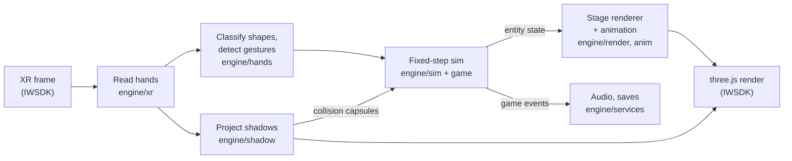

# Architecture

How Where Shadows Wander is put together: the layers, what runs each frame, which module does what, and the frame budget. The decisions behind it are in the [ADRs](adr/).

## Layers

```
IWSDK + three.js        XR session, renderer, display loop, emulator, plane/anchor systems
        │
Engine-facing code      src/app, src/engine/xr, src/engine/shadow, src/engine/render,
        │               src/engine/anim (adapters), src/engine/services, src/ui, src/debug, src/input-mock
        │
Pure code               src/engine/hands, src/engine/sim, src/engine/stage, src/game, src/engine/shadow/pure
                        (plain TypeScript; no IWSDK, three.js or browser globals)
```

- **IWSDK** owns the XR session, the renderer and the display loop. We use it for the session, the emulator, scene understanding (planes, anchors) and possibly spatial audio, and nothing else. Game state never goes into IWSDK's ECS ([ADR 0001](adr/0001-iwsdk-as-xr-and-view-layer.md)).
- **Engine-facing code** talks to IWSDK, three.js, WebXR and the DOM. It turns the outside world into plain data, and plain data into things on screen.
- **Pure code** holds the logic: hand maths and the classifier, the simulation, stage geometry and gameplay. It's unit-tested in Node and can't see the engine, which ESLint enforces. This is also why the plain three.js fallback stays cheap ([ADR 0002](adr/0002-plain-threejs-fallback.md)).

## One frame

IWSDK calls `renderer.setAnimationLoop` and runs its systems in priority order. We register exactly one system, `FrameDriverSystem` in `src/app/main.ts`, at priority 10. It runs after IWSDK's input (−4) and scene understanding (−1) systems and before rendering. Everything of ours runs inside it, in this order:



1. **Read hands and capabilities** (`engine/xr`): raw WebXR joints into `HandFrame`, 25 joints per hand in scene space ([ADR 0004](adr/0004-webcam-bench-and-hand-recordings.md)). In mock mode the webcam or a recording fills the same `HandFrame`. `CapabilityDetector` keeps one `Capabilities` object up to date (hands, passthrough, planes, meshes, anchors) and the detected planes as `DetectedPlane` records in scene space, normals toward the viewer, for StageFrame.
2. **Classify** (`engine/hands`): features, then the shape classifier with hold-to-commit and hysteresis, which emits shape events (`ShapeRecognizer`). Then the lantern gestures on the same features (`GestureDetector`): pinch-and-release to place or relight, a closed hand over the flame to pause.
3. **Shadows** (`engine/shadow`): `ShadowProjector` (pure, in `shadow/pure`) projects each hand onto the stage from the lantern with one matrix blended toward orthographic (k = 0.9), filling `HandShadow` (in `engine/hands`, for the solver): 28 capsules per hand in 2D stage space, an outline and an edge blur. `ShadowRenderer` draws both hands from those capsules in one draw call, soft-edged and clipped to the stage. Until StageFrame and the lantern exist, a stand-in rig (`shadow/pure/test-rig.ts`) places a paper screen and lantern in front of the player.
4. **Simulate** (`engine/sim`, `game`): the fixed-step loop advances the 2D simulation at a constant rate, whatever the display rate (72, 90 or 120 Hz). It returns an interpolation factor for rendering.
5. **Present** (`engine/render`, `engine/anim`): draw entity state (interpolated) as instanced sprites with animation poses.
6. **Services** (`engine/services`): audio and saves react to game events and never block a frame.
7. IWSDK renders the scene.

The stage is a 2D world on one real surface. `StageFrame` (`engine/stage`) converts between 3D scene space and 2D stage space, so the tabletop and wall modes run the same game.

## Modules

| Folder | Owner | Pure | Responsibility |
|---|---|---|---|
| `src/app` | Anson | No | Entry point: `World.create`, the driver system, wiring, the no-AR notice, IWSDK manifests |
| `src/engine/xr` | Anson | No | WebXR hand reading, capability detection, IWSDK workarounds, hand recorder |
| `src/engine/hands` | Anson | Yes | `HandFrame`, derived palm, shape features, classifier, gestures, recording format |
| `src/engine/shadow` | Anson | No (`pure/` yes) | Projected-shadow renderer; `pure/`: projection maths, capsules, stand-in rig |
| `src/input-mock` | Anson | No | Hand Lab (`?mock=1`) and its hand sources, webcam bench, MediaPipe conversion and worker |
| `src/engine/sim` | A | Yes | Fixed-step loop, 2D collision solver, entities, object pools |
| `src/engine/stage` | A | Yes | `StageFrame`: 3D ↔ 2D, choosing a table or wall, snapping |
| `src/game` | A | Yes | Traveller, shape abilities, puzzles, companions, discovery |
| `src/engine/render` | B | Adapters no | Stage renderer: instanced sprites, draw order, materials |
| `src/engine/anim` | B | Core yes | Procedural rod-puppet animation |
| `src/engine/services` | B | Adapters no | Saves (versioned, with migrations), assets, audio |
| `src/ui` | B | No | Onboarding, lantern flow, placement, chapter flow, settings |
| `src/debug` | B | No | Diagnostics report, anchor probe, profiler, Copy report panel |

"Adapters no" means only the thin layer that talks to IWSDK or three.js may import them; the logic behind it stays pure.

## Frame budget

At 72 fps a frame has **13.9 ms**. Judges require at least 60 fps (16.7 ms), so 72 gives margin. These are **CPU** budgets per frame. GPU time is separate, so measure it on the Pico.

| Module | Owner | Budget |
|---|---|---|
| IWSDK systems and three.js render submission | (engine) | 4.0 ms |
| Read hands, capabilities | Anson | 0.4 ms |
| Features, classifier, gestures | Anson | 0.7 ms |
| Shadow projection and capsules | Anson | 0.9 ms |
| Simulation and gameplay (all fixed steps in the frame) | A | 2.0 ms |
| Stage renderer and animation | B | 2.3 ms |
| Services (audio, saves, asset streaming) | B | 0.5 ms |
| Diagnostics and profiler | B | 0.3 ms |
| **Headroom** | | **2.8 ms** |
| **Total** | | **13.9 ms** |

These are starting estimates. Desktop measurements so far: our whole frame was about 0.06 ms, and 500 instanced quads about 0.08 ms. Expect a headset to be 3–5× slower. Teammate B's profiler (`src/debug`) will measure each module against this table on the Pico, and the table should be updated from real numbers.

## Compositing over passthrough

The stage and shadows are drawn into the same frame as the room camera image (`immersive-ar`, `alpha-blend`). What we hand the compositor, and how it is kept right:

| Rule | Why |
|---|---|
| The frame clears to transparent black and the scene has no background | IWSDK sets this itself in an AR session; the report's `render.clearAlpha` must be 0 |
| Stage materials are `transparent`, `premultipliedAlpha: false` and `toneMapped: false` | Blending `src-alpha` over a transparent clear stores premultiplied colour, which is what the compositor expects. Black stays black whatever tone mapping a scene environment adds |
| Draw order: hand occluder -1, paper 1, shadow 2, debug and stage sprites 3, joint dots 4 | Opaque things draw first, then the transparent paper and shadow, then overlays |
| `HandOccluder` draws each hand into the depth buffer only (no colour) | The paper and shadow cover the camera image, so without it a real hand held in front of the stage would be hidden behind them. Fragments behind the occluder fail the depth test and the camera image shows through. On in a headset; `?occlude=0` turns it off to compare |
| Any colour shader we add includes `colorspace_fragment` | The XR target is sRGB. Only black-only shaders (the shadow) may skip it |

Without a headset: `scripts/composite-probe.mjs <dev server URL>` renders the live scene into an sRGB RGBA8 target like WebXR's and reads the pixel at four stage points: off the stage (alpha 0), bare paper (alpha 0.85, premultiplied), inside a shadow (alpha 0.98), and paper behind a hand (alpha 0 with the occluder on). It cannot show what the headset's compositor then does with the frame; see the headset checklist in the pull request for #13.

The diagnostics report has a `render` section (`clearAlpha`, `toneMapping`, `outputColorSpace`, `blendMode`, `layer`, `handOccluder`) to read this off a real session. Stop and report if `clearAlpha` is not 0 in a session, the blend mode is `additive` or `opaque`, or the tone mapping is not `none`: black shadows are invisible on an additive display.

## Rules that keep it working

| Rule | Why |
|---|---|
| Pure code never imports the engine or browser globals | Logic stays unit-testable in Node, and the engine can be swapped ([ADR 0002](adr/0002-plain-threejs-fallback.md)) |
| No allocations in per-frame code | Garbage collection pauses cause dropped frames on a headset |
| One driver system; our own fixed-step loop | Simulation is deterministic and independent of display rate; IWSDK's private loop stays untouched ([ADR 0001](adr/0001-iwsdk-as-xr-and-view-layer.md)) |
| Raw WebXR, every feature optional and feature-detected | Works on Pico, Quest and the emulator alike ([ADR 0003](adr/0003-pico-as-stand-in-test-device.md)) |
| Exact version pins; one three.js | IWSDK is young and pins its own three.js fork ([ADR 0001](adr/0001-iwsdk-as-xr-and-view-layer.md)) |
| Lucide icon set aliased out | First load 0.7 MB instead of 1.7 MB ([ADR 0001](adr/0001-iwsdk-as-xr-and-view-layer.md)) |
| No top-level `await` in entry files | Deadlocks IWSDK's lazy chunk in production builds |
| IWSDK's hand meshes hidden every frame, its rays turned off | Players see their real hands in passthrough and never point at anything; IWSDK's own hand toggle doesn't work |

## Builds and deploys

- `npm run dev`: IWSDK's dev server with HTTPS and the IWER emulator (Quest 3, synthetic living room).
- `npm run build`: production build in `dist/`, with two pages: `index.html` (the game, and the Hand Lab with `?mock=1`) and `webcam.html` (the webcam bench). MediaPipe loads only on the bench and in the Hand Lab's webcam worker, never in the game's first load. Relative URLs, so it works under a GitHub Pages subpath.
- CI (`.github/workflows/ci.yml`) runs `npm run check` and a build on every PR. Merging to `main` deploys to GitHub Pages (`.github/workflows/pages.yml`).
